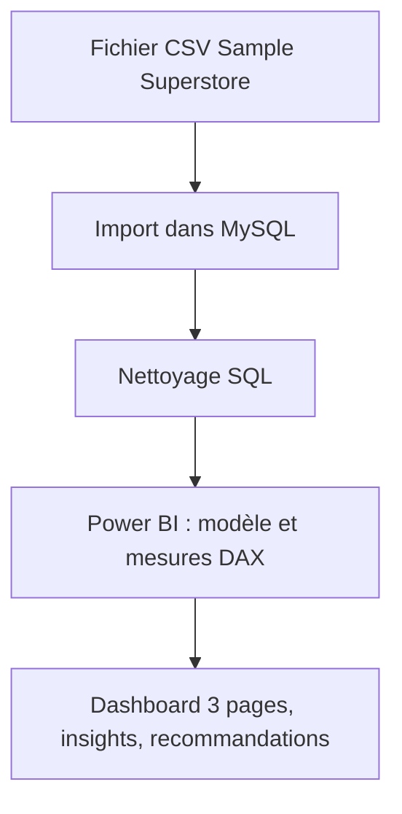
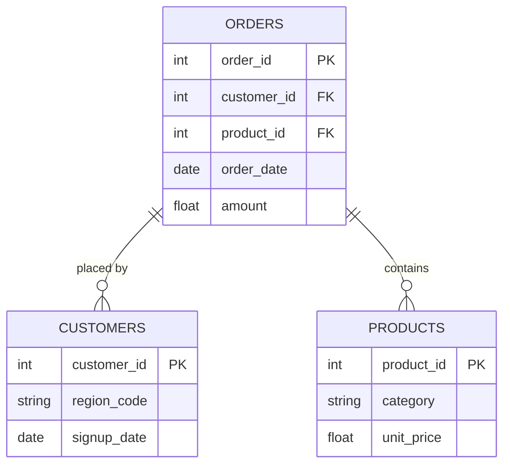

# [Project Title]
> *One sentence. What did you analyze, build, or solve - and why does it matter?*

---

## ⚙️ Project Type Flags
> *Check what applies. This helps reviewers and collaborators understand the nature of the work at a glance. Delete this block before publishing.*

- [ ] Exploratory Data Analysis (EDA)
- [ ] SQL Analysis / Querying
- [ ] Dashboard / Data Visualization
- [ ] Data Pipeline / ETL
- [ ] Predictive Modelling / Machine Learning
- [ ] Data Cleaning / Wrangling
- [ ] End-to-End (multiple of the above)
- [ ] Other: ___________

---

## Table of Contents
1. [Project Overview](#1-project-overview)
2. [Objectives](#2-objectives)
3. [Project Scope & Tools](#3-project-scope--tools)
4. [Repository Structure](#4-repository-structure)
5. [Data Workflow](#5-data-workflow)
6. [Data Model & Schema](#6-data-model--schema)
7. [ERD - Entity Relationship Diagram](#7-erd--entity-relationship-diagram) *(SQL projects)*
8. [Analysis & Metrics](#8-analysis--metrics)
9. [Key Insights](#9-key-insights)
10. [Recommendations](#10-recommendations)
11. [Assumptions & Limitations](#11-assumptions--limitations)
12. [Future Enhancements](#12-future-enhancements)
13. [Deliverables](#13-deliverables)
14. [Author](#14-author)

---

## 1. Project Overview

Un magasin de détail américain voyait ses ventes progresser d'année en année, sans savoir si cette croissance était réellement rentable. Ce projet analyse quatre ans de commandes (2014-2017) réparties sur quatre régions et trois catégories de produits, pour repérer où l'entreprise perd de l'argent et quel rôle jouent les remises. J'ai nettoyé les données en SQL, puis construit dans Power BI un dashboard de trois pages avec des mesures DAX pour comparer les années et isoler les produits déficitaires. L'analyse montre qu'en 2017 les ventes ont gagné 20,2 % mais le profit seulement 14,7 %, et que les ventes à plus de 40 % de remise ont fait perdre 0,12 M€, alors que Supplies, Bookcases et Tables vendent beaucoup sans dégager de marge.

**Context:** Sample Superstore est un jeu de données fictif de ventes d'un magasin de détail américain. Il couvre 3 catégories de produits (Technology, Furniture, Office Supplies), 3 segments de clients et 4 régions, de 2014 à 2017.

**Problem Statement:** Les ventes progressent, mais l'entreprise est-elle réellement rentable ? Où perd-elle de l'argent, et quel est l'effet des remises ?

**Approach:** J'ai nettoyé les données en SQL (MySQL), puis construit un dashboard Power BI de 3 pages (aperçu général, comparaison 2017 vs 2016, détail produit) avec des mesures DAX.

**Outcome:** En 2017, les ventes progressent de 20,2 % mais le profit de 14,7 % seulement, donc la marge recule de 0,6 point. Au-delà de 40 % de remise, le profit est de -0,12 M€, et Supplies, Bookcases et Tables vendent beaucoup mais ont une marge négative.


## 2. Objectives

- **Objectif principal :** Déterminer si la croissance des ventes de l'entreprise est réellement rentable et identifier où elle perd de l'argent.
- **Objectif secondaire 1 :** Mesurer les performances globales (ventes, profit, marge) et repérer les régions, catégories et segments qui pèsent le plus.
- **Objectif secondaire 2 :** Comparer 2017 à 2016 pour vérifier si la croissance s'accompagne d'une amélioration de la marge.
- **Objectif secondaire 3 :** Identifier les sous-catégories déficitaires et mesurer l'effet des remises sur le profit.


## 3. Project Scope & Tools

### Scope

| Dimension | Details |
|-----------|---------|
| **Dans le périmètre** | [Données au niveau des transactions pour les régions West, East, South et Central, de 2014 à 2017. L'analyse porte sur les ventes, le profit, la marge, la remise moyenne et la comparaison 2017 vs 2016, par catégorie, sous-catégorie et segment] |
| **Hors périmètre** | [Les coûts de livraison, les prix d'achat et les retours produits sont exclus, car ils ne figurent pas dans le jeu de données. Les prévisions pour les années suivantes sont exclues, car elles dépassent l'objectif du projet] |
| **Période** | [2014 à 2017, avec une comparaison de 2017 par rapport à 2016] |
| **Granularité** | [Une ligne par produit commandé, agrégée ensuite par région, catégorie, sous-catégorie, segment et année] |

### Outils & Téchnologies

| Catégories | Outil(s) utilisé(s) |
|----------|-------------|
| Source des données | Fichier CSV (Sample Superstore) |
| Stockage | MySQL |
| Traitement des données | SQL (MySQL Workbench) |
| Analyse et calculs | DAX (Power BI) |
| Visualisation | Power BI |
| Gestion de versions | Git / GitHub |
| Documentation | Markdown |


## 4. Repository Structure

```
[project-root]/
│
├── data/
│   ├── raw/                  # Original, unmodified source data - never edited
│   ├── processed/            # Cleaned and transformed data
│   └── external/             # Reference data, lookup tables, third-party files
│
│
├── scripts/                  # Reusable .py, .R, or .sh processing files
│
├── queries/                  # SQL files (retain this folder for SQL-heavy projects)
│   ├── exploratory/          # Ad-hoc or investigative queries
│   ├── transformations/      # Cleaning and reshaping logic
│   └── final/                # Production-ready or presentation queries
│
├── reports/                  # Final outputs: PDFs, slide decks, Word docs
│
├── visuals/                  # Exported charts, dashboard screenshots, ERD diagrams
│
├── docs/                     # Data dictionaries, schema notes, reference material
│
├── project_metadata.yml      # Machine-readable metadata (optional)
└── README.md                 # You are here
```


## 5. Flux de données



1. **Source :** fichier CSV Sample Superstore, un jeu de données public et fictif de ventes (2014-2017).
2. **Ingestion :** import du fichier dans une table MySQL, puis connexion de Power BI à la table nettoyée.
3. **Nettoyage :** [écrivez ici ce que vous avez corrigé en SQL, par exemple : doublons, format des dates, valeurs manquantes].
4. **Transformation :** création d'une table Calendrier, d'une colonne « Tranche remise » et de mesures DAX (marge, ventes et profit N-1, variations).
5. **Analyse :** comparaison de 2017 avec 2016, marge par sous-catégorie et effet des remises sur le profit.
6. **Résultat :** un dashboard Power BI de 3 pages, avec les insights et recommandations dans ce README.

## 6. Modèle de données et schéma

<!--
  Define your fields so that someone reading your analysis can follow along
  without digging through your code.

  WHAT GOOD LOOKS LIKE (one row example):
  | transaction_id | string | Unique identifier per sales transaction | TXN-00482 |
  | return_flag    | boolean | Whether the transaction included a return | TRUE |
  | region_code    | string | Two-letter identifier for store region | "NE" |

-->

### Ensemble de données / Table: `[[Sample_Superstore]]`

| Nom du champ | Type de données | Description | Exemple de valeur |
|------------|-----------|-------------|---------------|
| `Row_ID` | Entier | Identifiant unique de chaque ligne | 1 |
| `Order_ID` | Texte | Identifiant de la commande (répété sur chaque produit d'une même commande) | CA-2016-152156 |
| `Order_Date` | Date | Date de la commande | 2016-11-08 |
| `Ship_Date` | Date | Date d'expédition | 2016-11-11 |
| `Ship_Mode` | Texte | Mode d'expédition | Second Class |
| `Customer_ID` | Texte | Identifiant unique de chaque client | CG-12520 |
| `Customer_Name` | Texte | Nom du client (données fictives) | Claire Gute |
| `Segment` | Texte | Type de client : Consumer, Corporate ou Home Office | Consumer |
| `Country` | Texte | Pays de résidence du client | United States |
| `City` | Texte | Ville de résidence du client | Henderson |
| `State` | Texte | État américain du client | Kentucky |
| `Postal_Code` | Texte | Code postal du client | 42420 |
| `Region` | Texte | Région : West, East, South ou Central | South |
| `Product_ID` | Texte | Identifiant unique de chaque produit | FUR-BO-10001798 |
| `Category` | Texte | Catégorie du produit : Technology, Furniture ou Office Supplies | Furniture |
| `Sub_Category` | Texte | Sous-catégorie du produit (17 valeurs) | Bookcases |
| `Product_Name` | Texte | Nom du produit | Bush Somerset Collection Bookcase |
| `Sales` | Décimal | Montant des ventes de la ligne (€) | 261.96 |
| `Quantity` | Entier | Quantité de produits commandés | 2 |
| `Discount` | Décimal | Remise appliquée, de 0 à 1 (0,2 = 20 %) | 0 |
| `Profit` | Décimal | Profit de la ligne (€), négatif en cas de vente à perte | 41.91 |
> **Row count (approx.):** [X rows]
> **Date range:** [Start] – [End]


---

## 7. ERD - Entity Relationship Diagram
### *(Primarily for SQL Projects - remove this section if not applicable)*

<!--
  An ERD shows how your tables connect to each other visually.
  It is the fastest way for a reviewer to understand the data structure
  of a SQL project without reading every query.

  HOW TO INCLUDE YOUR ERD:
  Option A - Image embed (most common):
    Export your ERD from dbdiagram.io, DBeaver, Lucidchart, or similar.
    Save to /visuals/erd.png and reference it below.

  Option B - dbdiagram.io code block (version-controllable):
    Paste your schema definition code directly in the fenced block below.
    Anyone can paste it into dbdiagram.io to regenerate the visual.

  Option C - Mermaid diagram (renders natively in GitHub):
    Use the mermaid code block syntax below.
    GitHub will render this as a diagram automatically.

  PICK ONE. Don't use all three. Delete the options you don't use.
-->

### Option A - Embedded Image

*[Brief caption: e.g., "Three-table schema - orders, customers, and products joined on shared IDs."]*

---

### Option B - dbdiagram.io Schema Definition
```
Table orders {
  order_id    int     [pk]
  customer_id int     [ref: > customers.customer_id]
  product_id  int     [ref: > products.product_id]
  order_date  date
  amount      float
}

Table customers {
  customer_id int  [pk]
  region_code string
  signup_date date
}

Table products {
  product_id   int    [pk]
  category     string
  unit_price   float
}
```
*Paste this into [dbdiagram.io](https://dbdiagram.io) to view the visual.*

---

### Option C - Mermaid Diagram *(renders on GitHub)*


---

**Table Relationships Summary:**

| Relationship | Join Key | Type |
|-------------|----------|------|
| `orders` → `customers` | `customer_id` | Many-to-One |
| `orders` → `products` | `product_id` | Many-to-One |
| [Add rows as needed] | | |

---

## 8. Analyse et indicateurs

<!--
  Explain what you measured and how - before you share what you found.

  WHAT GOOD LOOKS LIKE:
  Metric: "Customer Return Rate"
  Definition: "Number of transactions flagged as returns divided by total
               transactions, calculated at product-category and regional grain."
  Why It Matters: "Return rate - not sales volume - was hypothesised to
                  explain regional revenue gaps. This metric tests that hypothesis."

  WHAT TO AVOID:
  ❌ Defining a metric only in code: SUM(returns) / COUNT(transaction_id)
     That's an implementation. Write the plain-language definition here.
     Both belong in your project - the definition in the README,
     the implementation in the code.
-->

### Approche analytique
<!--
[Describe how you approached the analysis. Were you exploring patterns? Testing a hypothesis? Building and validating a pipeline? Be honest about your method - exploratory work is valid, just call it that.]
-->
Mon approche a d'abord été exploratoire, puis elle s'est concentrée sur une hypothèse précise.
J'ai commencé par parcourir le jeu de données pour en vérifier la qualité (valeurs manquantes, doublons, anomalies) et chercher de premières tendances à l'aide de graphiques. Cette phase m'a conduit à comparer 2017 avec 2016, puis à regarder la répartition des ventes et du profit par catégorie, par région et par segment.

J'ai ensuite voulu vérifier une hypothèse : les remises élevées font-elles passer certaines ventes en perte ? Pour cela, j'ai regroupé les remises en tranches (0 %, 1-20 %, 21-40 %, plus de 40 %) et comparé le profit de chaque tranche, puis la marge et la remise moyenne par sous-catégorie. Cette vérification est visuelle et descriptive : elle met en évidence des corrélations, sans test statistique.

### Définition des indicateurs clés

| Indicateur | Définition | Pourquoi il compte |
|--------|--------------------------|----------------|
| Marge | le profit total divisé par le total des ventes  | Part de chaque euro vendu qui devient du profit |
| Lignes à perte | Part des lignes de commande à profit négatif | Mesure la fréquence des ventes à perte  |
| Remise moyenne | Taux de remise moyen, global et par sous-catégorie | Une remise trop forte réduit directement le profit |

### Méthodes utilisés

- **Statistiques descriptives** : sommes, moyennes et décomptes (ventes, profit, remise moyenne, nombre de commandes et de clients), et ratios dérivés comme la marge et la part de lignes à perte.
- **Analyse de tendance** : évolution annuelle des ventes et du profit de 2014 à 2017, présentée en courbes.
- **Comparaison N-1** : variation des ventes, du profit et de la marge entre 2017 et 2016, avec les fonctions de temps de DAX (SAMEPERIODLASTYEAR).
- **Comparaison de groupes** : ventes et profit par catégorie, région, segment et sous-catégorie, présentés en histogrammes et en tableau.
- **Regroupement en tranches** : remises classées en 4 tranches (0 %, 1-20 %, 21-40 %, plus de 40 %) pour comparer le profit de chacune.
- **Lecture visuelle d'une relation** : nuage de points de la remise moyenne contre la marge par sous-catégorie. Je n'ai pas calculé de coefficient de corrélation, donc je parle de tendance observée.
- **Nettoyage et transformation en SQL** : préparation de la table `Sample_Superstore_clean` avant le chargement dans Power BI.

---

## 9. Points clés

<!--
  Findings + implications. Not just what happened - what it means.

  WHAT GOOD LOOKS LIKE:
  ✅ "Return rates, not sales volume, explain Region A's underperformance.
      Region A's return rate on home goods was 34% - more than double the
      company average. Revenue was not lost at the point of sale; it was
      lost post-sale through refunds. This points to a fulfilment or
      product quality issue specific to that region, not a demand problem."

  WHAT TO AVOID:
  ❌ "Region A had lower revenue than other regions in Q4."
     (That's an observation. It describes what happened.
      An insight says what it means and where to look next.)

  Aim for 3–6 insights. Quality over quantity.
-->

**Point de vue n° 1: [Aperçu général (2014-2017)]**
La région West génère le profit le plus élevé (108,4 K€) et réalise les ventes les plus élevées (725,5 K€), alors que Central affiche le profit le plus faible (environ 40 K€) et South les ventes les plus faibles (391,0 K€). Les résultats sont donc très inégaux d'une région à l'autre, et les marges plus faibles de Central et South invitent à les surveiller de près. Du côté des produits, Technology réalise le profit le plus élevé (145,5 K€), devant Office Supplies (122,5 K€) et Furniture (18,9 K€), alors que les ventes des trois catégories restent proches (0,72 à 0,84 M€). Furniture semble donc la catégorie la moins rentable. Le segment Consumer pèse le plus en ventes (1,16 M€), devant Corporate (0,71 M€) et Home Office (0,43 M€), ce qui rend l'activité dépendante des particuliers. Enfin, le profit annuel passe de 49,5 K€ en 2014 à 93,9 K€ en 2017 : la tendance est positive, mais il faut vérifier que la marge progresse aussi, ce que montre la page suivante.

**Point de vue n° 2: [Analyse N-1 (2017 vs 2016)]**
En 2017, les ventes progressent de 20,2 % et le profit de 14,7 %, ce qui fait reculer la marge de 0,6 point (12,81 %). La croissance semble donc obtenue au détriment de la rentabilité, peut-être à cause des remises ou d'une hausse des coûts. Par catégorie, Technology et Office Supplies progressent, alors que Furniture recule (3 K€ en 2017 contre 7 K€ en 2016) et fragilise le résultat global. Par région, West (44 K€ contre 24 K€) et East (33 K€ contre 20 K€) progressent, tandis que South (9 K€ contre 18 K€) et Central (8 K€ contre 20 K€) reculent : ces deux régions rencontrent un problème absent à l'Ouest et à l'Est, dont les causes restent à identifier. Par segment, Consumer (45,6 K€ contre 35,8 K€) et Home Office (21,1 K€ contre 15,0 K€) progressent, tandis que Corporate est le seul à baisser (27 K€ contre 31 K€), ce qui oriente l'analyse vers un segment précis. Côté marge, Labels, Paper et Envelopes affichent les valeurs les plus élevées et peuvent servir de référence de rentabilité.

**Point de vue n° 3: [Détail produit]**
Au-delà de 40 % de remise, le profit est de -0,12 M€ : les fortes remises détruisent de la valeur, et un plafond de remise est une piste directe. Tables (-8,39 %), Bookcases (-3,02 %) et Supplies (-2,55 %) ont une marge négative. Tables et Bookcases réalisent pourtant des ventes élevées (206 K€ et 115 K€), ce qui laisse penser que la demande existe mais qu'elle est obtenue à des conditions non rentables. La remise est une cause possible, avec une moyenne de 26 % pour Tables et 21 % pour Bookcases, mais pas la seule : Binders a une remise moyenne de 37 % et reste rentable. Par ailleurs, 26,31 % des lignes de commande sont déficitaires, ce qui indique que les pertes sont fréquentes et que le problème semble structurel. À l'inverse, Labels affiche la meilleure marge (44,42 %), preuve qu'une forte rentabilité est possible dans cette activité.

---

## 10. Recommendations

<!--
  Action-oriented. Addressed to a real audience.
  Tied explicitly to the insight that supports each one.

  WHAT GOOD LOOKS LIKE:
  Priority: High
  Recommendation: "Conduct a fulfilment audit for home goods deliveries
                   in Region A - specifically investigating whether returns
                   correlate with a particular warehouse, carrier, or SKU batch."
  Based On: Insight 1 - return rate anomaly in Region A
  Owner: Operations / Supply Chain team

  WHAT TO AVOID:
  ❌ "Improve the return rate."
     (Not actionable. Doesn't say who, how, or where to start.)
  ❌ "Further analysis is needed."
     (This is a placeholder, not a recommendation.)
-->

| Priority | Recommendation | Based On | Suggested Owner |
|----------|---------------|----------|-----------------|
| High | [Encadrer la politique de remise en plafonnant les taux et en surveillant en priorité les ventes au-delà de 40 % | Point de vue n° 3 - Détail produit | [Who should act] |
| Medium | Suivre la marge et pas seulement le chiffre d'affaires |Point de vue n° 2 Analyse N-1 (2017 vs 2016)| [Who should act] |
| Low | [Exploratory or longer-term suggestion] | [Insight it comes from] | [Who should act] |

---

## 11. Hypothèses et limites

<!--
  WHAT GOOD LOOKS LIKE:
  Assumption: "Transaction records were assumed to be complete for all five regions.
               No validation was performed against source system record counts."
  Limitation: "The analysis cannot distinguish between returns initiated by
               the customer vs. returns initiated by the business (e.g., recalls).
               If business-initiated returns are concentrated in Region A, the
               return rate finding may reflect a policy decision, not a quality issue."

  WHAT TO AVOID:
  ❌ Leaving this section blank or writing "None known."
     Every project has limitations. Documenting them is a sign of
     analytical maturity - not a confession of failure.
-->

### Assumptions
- [What did you treat as true without being able to verify?]
- [What simplifications did you make for scope or feasibility?]
- [What domain rules or definitions did you accept as given?]

### Limites
Sample Superstore est un jeu de données public et fictif : les résultats ne reflètent pas une entreprise réelle. L'analyse met en évidence des corrélations et non des causalités, car les coûts, la livraison et les prix ne figurent pas dans les données. Les données sont statiques, sans actualisation automatique.

> *The goal here is pre-emptive Q&A. What would a thoughtful skeptic push back on? Document the answer here, before they ask.*

---

## 12. Pistes d'analyse complémentaires

<!--
  WHAT GOOD LOOKS LIKE:
  ✅ "Automate the monthly data pull from the POS export folder using
      a scheduled Python script, replacing the current manual process."
  ✅ "Expand the return rate analysis to include carrier-level data,
      which was unavailable in this dataset but exists in the logistics system."

  WHAT TO AVOID:
  ❌ "Add a machine learning model."
     (Vague, and disconnected from the actual findings of this project.)
  ❌ Listing aspirational features that don't follow logically from the work.
-->

- [ ] [Enhancement 1 - Existe-t-il des périodes où les ventes augmentent mais où le profit diminue ?]
- [ ] [Enhancement 2 - Quelles sous-catégories ont une marge inférieure à la marge globale de 12,49 % ?]
- [ ] [Enhancement 3 - Quelles combinaisons Région × Catégorie ont une marge négative, et lesquelles sont les plus rentables ?]

---

## 13. Deliverables

| Deliverable | Description | Location |
|-------------|-------------|----------|
| [Name] | [What it contains] | [`/path/to/file`] |
| [Name] | [What it contains] | [`/path/to/file`] |
| [Name] | [What it contains] | [`/path/to/file`] |

---

## 14. Author

**[Your Name]**
[Your role or title - current or target]

- 🔗 [LinkedIn URL]
- 💼 [Portfolio or GitHub profile URL]
- 📧 [Email - optional]

---

*Last updated: [Month YYYY]*
*If this template helped you, consider starring the repository.*
