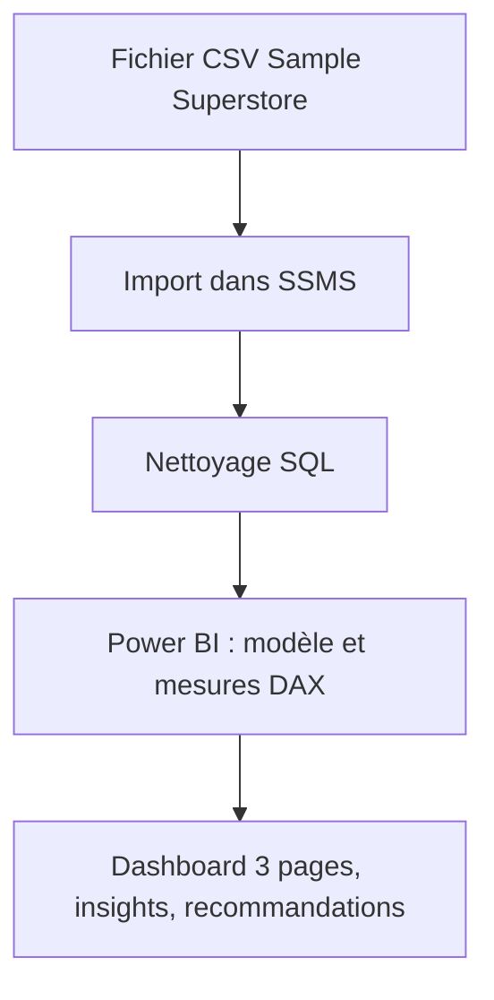
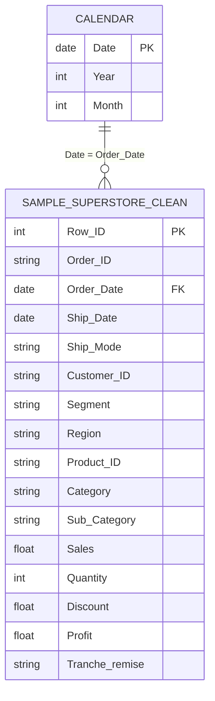

# Vendre plus, gagner moins ? Impact des remises sur la rentabilité
> *les ventes à plus de 40 % de remise font perdre de l’argent*

---


> Analyse SQL et Power BI du jeu de données Sample Superstore (2014-2017)
---

## Table des matières
1. [Présentation du projet](#1-présentation-du-projet)
2. [Objectifs](#2-objectifs)
3. [Portée du projet et outils](#3-project-scope-tools)
4. [Structure du dépôt](#4-structure-du-dépôt)
5. [Flux de données](#5-flux-de-données)
6. [Modèle de données et schéma](#6-modèle-de-données-et-schéma)
7. [ERD - Diagramme entité-relation](#7-erd-Diagramme-entité-relation) *(SQL projects)*
8. [Analyse et indicateurs](#8-analyse-et-indicateurs)
9. [Points clés](#9-points-clés)
10. [Recommandations](#10-recommandations)
11. [Hypothèses et limites](#11-hypothèses-et-limites)
12. [Pistes d'analyse complémentaires)](#12-pistes--d'analyse-complémentaires)
13. [Livrables](#13-livrables)
14. [Auteur](#14-auteur)

---

## 1. Présentation du projet

Sample Superstore est un jeu de données fictif qui retrace quatre ans de commandes (2014-2017) d'un magasin de détail américain, réparties sur quatre régions, trois catégories de produits et trois segments de clients. Dans ce projet, je me suis demandé si la croissance des ventes était réellement rentable, et où l'entreprise perdait de l'argent, notamment à cause des remises. J'ai nettoyé les données en SQL (SQL Server Management Studio), puis construit dans Power BI un dashboard de trois pages (aperçu général, comparaison 2017 contre 2016, détail produit) avec des mesures DAX. Résultat : en 2017, les ventes progressent de 20,2 % mais le profit de 14,7 % seulement, donc la marge recule de 0,6 point. Les ventes à plus de 40 % de remise font perdre 0,12 M€, et Tables et Bookcases se vendent bien mais ont une marge négative.


## 2. Objectifs

- **Objectif principal :** Déterminer si la croissance des ventes de l'entreprise est réellement rentable et identifier où elle perd de l'argent.
- **Objectif secondaire 1 :** Mesurer les performances globales (ventes, profit, marge) et repérer les régions, catégories et segments qui pèsent le plus.
- **Objectif secondaire 2 :** Comparer 2017 à 2016 pour vérifier si la croissance s'accompagne d'une amélioration de la marge.
- **Objectif secondaire 3 :** Identifier les sous-catégories déficitaires et mesurer l'effet des remises sur le profit.


## 3. Portée du projet et outils

### Portée du projet

| Dimension | Details |
|-----------|---------|
| **Dans le périmètre** | Données au niveau des transactions pour les régions West, East, South et Central, de 2014 à 2017. L'analyse porte sur les ventes, le profit, la marge, la remise moyenne et la comparaison 2017 vs 2016, par catégorie, sous-catégorie et segment |
| **Hors périmètre** | Les coûts de livraison, les prix d'achat et les retours produits sont exclus, car ils ne figurent pas dans le jeu de données. Les prévisions pour les années suivantes sont exclues, car elles dépassent l'objectif du projet |
| **Période** | 2014 à 2017, avec une comparaison de 2017 par rapport à 2016 |
| **Granularité** | Une ligne par produit commandé, agrégée ensuite par région, catégorie, sous-catégorie, segment et année |

### Outils & Technologies

| Catégories | Outil(s) utilisé(s) |
|----------|-------------|
| Source des données | Fichier CSV (Sample Superstore) |
| Stockage | MySQL |
| Traitement des données | SQL (SSMS: SQL Server Management Studio) |
| Analyse et calculs | DAX (Power BI) |
| Visualisation | Power BI |
| Gestion de versions | Git / GitHub |
| Documentation | Markdown |


## 4. Structure du dépôt

```
superstore-discount-profitability-analysis/
├── data/
│   ├── raw/           # Fichier CSV d'origine
│   └── processed/     # Données nettoyées
├── queries/           # Scripts SQL de nettoyage
├── dashboard/         # Fichier .pbix
├── visuals/           # Captures des 3 pages, ERD
├── reports/           # Export PDF du dashboard
└── README.md
```


## 5. Flux de données



1. **Source :** fichier CSV Sample Superstore, un jeu de données public et fictif de ventes (2014-2017).
2. **Ingestion :** import du fichier dans une table SQL Server Management Studio (SSMS), puis connexion de Power BI à la table nettoyée.
3. **Nettoyage :** Nettoyage des données consiste à supprimer les doublons, vérifier la format des dates et supprimer les valeurs manquantes, le nombre du lignes au début était de 9 994 et après le nettoyage j'ai supprimé une ligne où le profit.
4. **Transformation :** création d'une table Calendrier, d'une colonne « Tranche remise » et de mesures DAX (marge, ventes et profit N-1, variations).
5. **Analyse :** comparaison de 2017 avec 2016, marge par sous-catégorie et effet des remises sur le profit.
6. **Résultat :** un dashboard Power BI de 3 pages, avec les insights et recommandations dans ce README.

## 6. Modèle de données et schéma

<!--
  Define your fields so that someone reading your analysis can follow along
  without digging through your code.

  WHAT GOOD LOOKS LIKE (one row example):
  | transaction_id | string | Unique identifier per sales transaction | TXN-00482 |
  | return_flag    | boolean | Whether the transaction included a return | TRUE |
  | region_code    | string | Two-letter identifier for store region | "NE" |

-->

### Ensemble de données / Table: `[Sample_Superstore_clean]`

| Nom du champ | Type de données | Description | Exemple de valeur |
|------------|-----------|-------------|---------------|
| `Row_ID` | Entier | Identifiant unique de chaque ligne | 1 |
| `Order_ID` | Texte | Identifiant de la commande (répété sur chaque produit d'une même commande) | CA-2016-152156 |
| `Order_Date` | Date | Date de la commande | 2016-11-08 |
| `Ship_Date` | Date | Date d'expédition | 2016-11-11 |
| `Ship_Mode` | Texte | Mode d'expédition | Second Class |
| `Customer_ID` | Texte | Identifiant unique de chaque client | CG-12520 |
| `Customer_Name` | Texte | Nom du client (données fictives) | Claire Gute |
| `Segment` | Texte | Type de client : Consumer, Corporate ou Home Office | Consumer |
| `Country` | Texte | Pays de résidence du client | United States |
| `City` | Texte | Ville de résidence du client | Henderson |
| `State` | Texte | État américain du client | Kentucky |
| `Postal_Code` | Texte | Code postal du client | 42420 |
| `Region` | Texte | Région : West, East, South ou Central | South |
| `Product_ID` | Texte | Identifiant unique de chaque produit | FUR-BO-10001798 |
| `Category` | Texte | Catégorie du produit : Technology, Furniture ou Office Supplies | Furniture |
| `Sub_Category` | Texte | Sous-catégorie du produit (17 valeurs) | Bookcases |
| `Product_Name` | Texte | Nom du produit | Bush Somerset Collection Bookcase |
| `Sales` | Décimal | Montant des ventes de la ligne ($) | 261.96 |
| `Quantity` | Entier | Quantité de produits commandés | 2 |
| `Discount` | Décimal | Remise appliquée, de 0 à 1 (0,2 = 20 %) | 0 |
| `Profit` | Décimal | Profit de la ligne ($), négatif en cas de vente à perte | 41.91 |
| `Tranche_remise` | Texte | Tranche de remise de la ligne : 1. 0 %, 2. 1-20 %, 3. 21-40 % ou 4. > 40 %. Colonne calculée dans Power BI | 2. 1-20 % |
> **Row count (approx.):** [9 993]
> **Date range:** [03-01-2014] – [30-12-2017]


La table `Calendar` n'existe pas dans les données d'origine : je l'ai créée dans Power BI avec DAX, avec une ligne par date (colonnes Date, Year et Month). Elle est reliée à `Order_Date` et sert surtout aux comparaisons avec l'année précédente (N-1).

---

## 7. ERD - Diagramme entité-relation


<!--
  An ERD shows how your tables connect to each other visually.
  It is the fastest way for a reviewer to understand the data structure
  of a SQL project without reading every query.

  HOW TO INCLUDE YOUR ERD:
  Option A - Image embed (most common):
    Export your ERD from dbdiagram.io, DBeaver, Lucidchart, or similar.
    Save to /visuals/erd.png and reference it below.

  Option B - dbdiagram.io code block (version-controllable):
    Paste your schema definition code directly in the fenced block below.
    Anyone can paste it into dbdiagram.io to regenerate the visual.

  Option C - Mermaid diagram (renders natively in GitHub):
    Use the mermaid code block syntax below.
    GitHub will render this as a diagram automatically.

  PICK ONE. Don't use all three. Delete the options you don't use.
-->

### Mermaid Diagram 
Modèle simple : une table de faits et une table de dates

**Table Relationships Summary:**

| Relationship | Join Key | Type |
|-------------|----------|------|
| `Calendar[Date]` → `Order_Date` | `date Date` | Un à plusieurs |


---

## 8. Analyse et indicateurs

<!--
  Explain what you measured and how - before you share what you found.

  WHAT GOOD LOOKS LIKE:
  Metric: "Customer Return Rate"
  Definition: "Number of transactions flagged as returns divided by total
               transactions, calculated at product-category and regional grain."
  Why It Matters: "Return rate - not sales volume - was hypothesised to
                  explain regional revenue gaps. This metric tests that hypothesis."

  WHAT TO AVOID:
  ❌ Defining a metric only in code: SUM(returns) / COUNT(transaction_id)
     That's an implementation. Write the plain-language definition here.
     Both belong in your project - the definition in the README,
     the implementation in the code.
-->

### Approche analytique
<!--
[Describe how you approached the analysis. Were you exploring patterns? Testing a hypothesis? Building and validating a pipeline? Be honest about your method - exploratory work is valid, just call it that.]
-->
Mon approche a d'abord été exploratoire, puis elle s'est concentrée sur une hypothèse précise.
J'ai commencé par parcourir le jeu de données pour en vérifier la qualité (valeurs manquantes, doublons, anomalies) et chercher de premières tendances à l'aide de graphiques. Cette phase m'a conduit à comparer 2017 avec 2016, puis à regarder la répartition des ventes et du profit par catégorie, par région et par segment.

J'ai ensuite voulu vérifier une hypothèse : les remises élevées font-elles passer certaines ventes en perte ? Pour cela, j'ai regroupé les remises en tranches (0 %, 1-20 %, 21-40 %, plus de 40 %) et comparé le profit de chaque tranche, puis la marge et la remise moyenne par sous-catégorie. Cette vérification est visuelle et descriptive : elle met en évidence des corrélations, sans test statistique.

### Définition des indicateurs clés

| Indicateur | Définition | Pourquoi il compte |
|--------|--------------------------|----------------|
| Marge | le profit total divisé par le total des ventes  | Part de chaque euro vendu qui devient du profit |
| Lignes à perte | Part des lignes de commande à profit négatif (26,31 % sur l'ensemble des données, 2014-2017) | Mesure la fréquence des ventes à perte  |
| Remise moyenne | Taux de remise moyen, global et par sous-catégorie | Une remise trop forte réduit directement le profit |


### Méthodes utilisées

- **Statistiques descriptives** : sommes, moyennes et décomptes (ventes, profit, remise moyenne, nombre de commandes et de clients), et ratios dérivés comme la marge et la part de lignes à perte.
- **Analyse de tendance** : évolution annuelle des ventes et du profit de 2014 à 2017, présentée en courbes.
- **Comparaison N-1** : variation des ventes, du profit et de la marge entre 2017 et 2016, avec les fonctions de temps de DAX (SAMEPERIODLASTYEAR).
- **Comparaison de groupes** : ventes et profit par catégorie, région, segment et sous-catégorie, présentés en histogrammes et en tableau.
- **Regroupement en tranches** : remises classées en 4 tranches (0 %, 1-20 %, 21-40 %, plus de 40 %) pour comparer le profit de chacune.
- **Lecture visuelle d'une relation** : nuage de points de la remise moyenne contre la marge par sous-catégorie. Je n'ai pas calculé de coefficient de corrélation, donc je parle de tendance observée.
- **Nettoyage et transformation en SQL** : préparation de la table `Sample_Superstore_clean` avant le chargement dans Power BI.

---

## 9. Points clés

<!--
  Findings + implications. Not just what happened - what it means.

  WHAT GOOD LOOKS LIKE:
  ✅ "Return rates, not sales volume, explain Region A's underperformance.
      Region A's return rate on home goods was 34% - more than double the
      company average. Revenue was not lost at the point of sale; it was
      lost post-sale through refunds. This points to a fulfilment or
      product quality issue specific to that region, not a demand problem."

  WHAT TO AVOID:
  ❌ "Region A had lower revenue than other regions in Q4."
     (That's an observation. It describes what happened.
      An insight says what it means and where to look next.)

  Aim for 3–6 insights. Quality over quantity.
-->

**Point clé 1 : la croissance de 2017 se fait au détriment de la marge.**
En 2017, les ventes progressent de 20,2 % mais le profit de 14,7 % seulement, donc la marge recule de 0,6 point (12,81 %). L'entreprise vend plus, mais gagne moins sur chaque euro vendu. Les remises sont une explication possible, qui se confirme dans le point 3.

**Point clé 2 : les ventes se ressemblent d'une catégorie à l'autre, pas les profits.**
Technology, Furniture et Office Supplies réalisent des ventes proches (entre 0,72 et 0,84 M€), mais Technology dégage 145,5 K€ de profit, Office Supplies 122,5 K€ et Furniture seulement 18,9 K€. En 2017, Furniture est aussi la seule catégorie dont le profit recule (3 K€ contre 7 K€ en 2016). C'est donc elle qu'il faut regarder en priorité.

**Point clé 3 : au-delà de 40 % de remise, l'entreprise perd de l'argent.**
Les ventes à plus de 40 % de remise font perdre 0,12 M€, alors que les ventes sans remise rapportent environ 0,32 M€. En tout, 26,31 % des lignes de commande sont déficitaires : les ventes à perte sont fréquentes, pas accidentelles.

**Point clé 4 : Tables, Bookcases et Supplies perdent de l'argent, et la remise n'explique pas tout.**
Ces trois sous-catégories ont une marge négative (-8,39 %, -3,02 % et -2,55 %). Tables et Bookcases se vendent pourtant bien (206 K€ et 115 K€ de ventes) : il y a de la demande, mais à des conditions qui ne rapportent rien. Leur remise moyenne (26 % et 21 %) est une piste, mais Binders accorde 37 % de remise en moyenne et reste rentable (marge de 14,86 %). Les prix ou les coûts jouent sans doute aussi un rôle, que ces données ne permettent pas de mesurer.

**Point clé 5 : le recul de 2017 est concentré sur quelques régions et un segment.**
West (44 K€ contre 24 K€) et East (33 K€ contre 20 K€) progressent, alors que South (9 K€ contre 18 K€) et Central (8 K€ contre 20 K€) reculent de moitié ou plus. Côté segments, Consumer et Home Office progressent, mais Corporate baisse (27 K€ contre 31 K€). Ce n'est donc pas toute l'entreprise qui ralentit, et c'est là qu'il faut chercher les causes.

---

## 10. Recommandations

<!--
  Action-oriented. Addressed to a real audience.
  Tied explicitly to the insight that supports each one.

  WHAT GOOD LOOKS LIKE:
  Priority: High
  Recommendation: "Conduct a fulfilment audit for home goods deliveries
                   in Region A - specifically investigating whether returns
                   correlate with a particular warehouse, carrier, or SKU batch."
  Based On: Insight 1 - return rate anomaly in Region A
  Owner: Operations / Supply Chain team

  WHAT TO AVOID:
  ❌ "Improve the return rate."
     (Not actionable. Doesn't say who, how, or where to start.)
  ❌ "Further analysis is needed."
     (This is a placeholder, not a recommendation.)
-->

| Priorité | Recommandation | Basée sur | Responsable suggéré |
|----------|---------------|----------|-----------------|
| Haute | Encadrer la politique de remise en plafonnant les taux et en surveillant en priorité les ventes au-delà de 40 % | Point de vue n° 3 - Détail produit | Direction commerciale |
| Moyenne | Suivre la marge et pas seulement le chiffre d'affaires |Point de vue n° 2 Analyse N-1 (2017 vs 2016)| Contrôle de gestion |
| Moyenne | Investiguer les reculs de 2017 (South, Central, Corporate, Furniture) |Point de vue n° 2 Analyse N-1 (2017 vs 2016)| Directions régionales |
| Basse | Analyse croisée Région × Catégorie | Point de vue n° 2 Analyse N-1 (2017 vs 2016) | Équipe data |

---

## 11. Hypothèses et limites

<!--
  WHAT GOOD LOOKS LIKE:
  Assumption: "Transaction records were assumed to be complete for all five regions.
               No validation was performed against source system record counts."
  Limitation: "The analysis cannot distinguish between returns initiated by
               the customer vs. returns initiated by the business (e.g., recalls).
               If business-initiated returns are concentrated in Region A, the
               return rate finding may reflect a policy decision, not a quality issue."

  WHAT TO AVOID:
  ❌ Leaving this section blank or writing "None known."
     Every project has limitations. Documenting them is a sign of
     analytical maturity - not a confession of failure.
-->

### Hypothèses
- J’ai affiché « n.s. » (non significatif) quand le profit de l’année précédente était négatif, parce qu’un pourcentage de variation n’a plus de sens dans ce cas.
- J’ai gardé les lignes à profit négatif, parce que je les ai considérées comme de vraies ventes à perte et pas comme des erreurs.
- J’ai calculé la marge sur les totaux (profit total divisé par ventes totales), et pas en faisant la moyenne des marges de chaque ligne.

### Limites
Sample Superstore est un jeu de données public et fictif : les résultats ne reflètent pas une entreprise réelle. L'analyse met en évidence des corrélations et non des causalités, car les coûts, la livraison et les prix ne figurent pas dans les données. Les données sont statiques, sans actualisation automatique.


---

## 12. Pistes d'analyse complémentaires

<!--
  WHAT GOOD LOOKS LIKE:
  ✅ "Automate the monthly data pull from the POS export folder using
      a scheduled Python script, replacing the current manual process."
  ✅ "Expand the return rate analysis to include carrier-level data,
      which was unavailable in this dataset but exists in the logistics system."

  WHAT TO AVOID:
  ❌ "Add a machine learning model."
     (Vague, and disconnected from the actual findings of this project.)
  ❌ Listing aspirational features that don't follow logically from the work.
-->

- [ ] - Rechercher les périodes où les ventes augmentent alors que le profit baisse .
- [ ] - Identifiez et analysez les sous-catégories dont la marge bénéficiaire est inférieure à la marge globale de 12,49 %.
- [ ] - Analyser les combinaisons Région × Catégorie pour repérer celles qui ont une marge négative et celles qui sont les plus rentables, afin de cibler les actions correctives et de s’appuyer sur les combinaisons performantes.

---

## 13. Livrables

| Deliverable | Description | Location |
|-------------|-------------|----------|
| Dashboard Power BI (aperçu) | Captures des 3 pages du rapport | [Page 1](<visuals/page1/Apeçu général.PNG>) · [Page 2](<visuals/page2/Analyse_N-1.PNG>) · [Page 3](<visuals/page3/Détail produit.PNG>) |
| Export PDF | [What it contains] | [`/path/to/file`] |
| Script de nettoyage SQL| Transformation de la table brute | [`queries/transformations/SQLTransformation.sql`](queries/transformations/SQLTransformation.sql) |
| ERD (diagramme entité-relation) | Schéma du modèle : table de faits et table de dates | [Section 7 de ce README](#7-erd-diagramme-entité-relation) |

---

## 14. Auteur

**Maha HOSNI**
Data analyst junior


- 💼 [Portfolio or GitHub profile URL]
- 📧 mahamh.hosni@gmail.com

---


